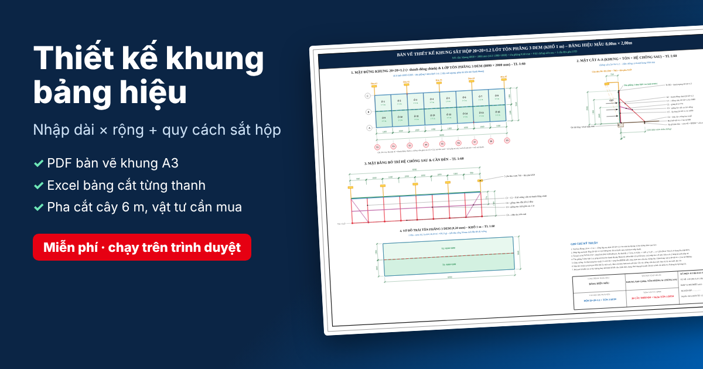

# Thiết kế khung bảng hiệu – xuất PDF bản vẽ & Excel bóc tách

**Dùng ngay:** https://datnho0804-gif.github.io/BH_GHN/

Nhập **chiều dài × chiều rộng** bảng hiệu và chọn **quy cách sắt hộp** → bấm **Xuất PDF thiết kế** và **Xuất Excel bóc tách**.
Miễn phí, chạy ngay trên trình duyệt (máy tính và điện thoại), không cần đăng ký, không gửi dữ liệu đi đâu.

## Cách dùng

1. Mở link trên (Chrome, Edge, Safari, Cốc Cốc…).
2. Nhập **chiều dài** và **chiều rộng** bảng hiệu theo mm (hoặc gõ số mét: `8` và `2` = 8000 × 2000 mm).
3. Chọn **quy cách sắt hộp** – để *Tự động* nếu muốn app đề xuất (bảng ≤ 8 m × 2 m dùng hộp mạ kẽm 20×20×1.2).
4. Bấm **Xuất PDF thiết kế** (bản vẽ khung, mặt cắt, mặt bằng chống, trải tôn, bảng kê từng thanh cắt, sơ đồ pha cắt cây 6 m, vật tư cần mua – khổ A3) và **Xuất Excel bóc tách**.
5. Cần chỉnh thêm (dựng trên mái hay áp tường, đèn pha, vùng gió, khổ giấy, tên công trình…) thì mở mục **Tùy chọn nâng cao**.

Cài lên điện thoại như một ứng dụng: mở link bằng Chrome → menu ⋮ → **Thêm vào màn hình chính** (iPhone: Safari → Chia sẻ → **Thêm vào MH chính**). Sau lần mở đầu tiên, app vẫn mở lại được khi mất mạng.

## Tính năng

- **Bản vẽ khung bảng hiệu**: mặt đứng khung + lớp tôn, mặt cắt A-A (khung, tôn, hệ chống sau, cần đèn), mặt bằng bố trí hệ chống/pát, sơ đồ trải tôn, khung tên – khổ A3/A2/A1. Xuất **PDF** (vector, chữ tiếng Việt), **DXF** (AutoCAD, tỷ lệ 1:1, mm), **SVG**, **PNG**.
- **Bóc tách khối lượng**: liệt kê **từng thanh cắt** (ký hiệu, quy cách, dài cắt chính xác theo mép thanh, số lượng, vị trí lắp), **sơ đồ pha cắt cây 6 m** (mạch cắt 3 mm, cắt vuông đầu cây 10 mm), tôn phẳng, **vật tư cần mua** (số cây thép, m dài tôn, đinh rút/vít, bát, tắc kê, vít mái, keo, que hàn, đá cắt, sơn kẽm lạnh, đèn).
- **Excel (.xlsx)** 6 sheet (font Times New Roman, có công thức) hoặc **CSV**.

### Quy tắc vật liệu áp dụng

| Lựa chọn | Vật liệu khung | Ghi chú |
|---|---|---|
| Chọn một quy cách cụ thể | Dùng đúng quy cách đó cho toàn bộ khung, thanh chống, giằng, cần đèn | App tự chọn bước chống và ốp lưng (cùng quy cách) để đạt kiểm tra gió; nếu quy cách quá yếu vẫn lập bản vẽ nhưng cảnh báo và đề xuất quy cách thay thế |
| *Tự động*, dài ≤ 8 m **và** cao ≤ 2 m | Hộp mạ kẽm **20×20×1.2** cho toàn bộ khung, thanh chống, giằng | Thanh đứng chính chịu lực lớn được ốp lưng thêm 1 thanh 20×20×1.2 (C5) khi kiểm tra gió yêu cầu |
| *Tự động*, lớn hơn | Tự chọn quy cách hộp vuông/chữ nhật thông dụng | Thử bước chống 1–4 khoang × các quy cách, chọn phương án **đạt kiểm tra gió** có **chi phí so sánh thấp nhất** (thép theo số cây phải mua + mối hàn + chân chống/pát) |
| Mặt bảng | **Tôn phẳng 3 dem (0,30 mm), khổ 1 m** – cố định | Giáp mí trên tim thanh khung, bước ô mặc định 1000 mm |

Kiểm tra kết cấu là **sơ bộ** theo tải gió TCVN 2737 (khung phẳng 2D cho tuyến chống, dầm tải 2 phương cho ô lưới, ổn định thanh nén theo đường cong EC3-c). Không thay thế thiết kế kết cấu chính thức.

### Dành cho chủ repo: phát hành bằng GitHub Pages (miễn phí)

1. Repo (tên hiện tại: `BH_GHN`) phải ở chế độ **public** (gói GitHub miễn phí): **Settings → General → Danger Zone → Change visibility → Change to public**.
2. **Settings → Pages → Build and deployment → Source: Deploy from a branch** → Branch **`main`**, thư mục **`/docs`** → **Save**.
3. Sau 1–2 phút, app chạy tại `https://datnho0804-gif.github.io/BH_GHN/` (đường link hiện ở đầu trang Settings → Pages).
4. Mỗi lần cập nhật code vào `main`, GitHub tự đăng lại bản mới. Khi phát hành bản mới, tăng `VERSION` trong `docs/sw.js` để điện thoại đã cài app nhận bản mới.

> Nếu đổi tên repo, đường link app đổi theo (GitHub **không** tự chuyển link trang web cũ sang tên mới) – cập nhật lại các thẻ `og:url`, `og:image`, `canonical` và link mã nguồn trong `docs/index.html`, rồi gửi lại link mới cho người dùng.

### Dùng không cần mạng

Mở trực tiếp file `docs/index.html` bằng Chrome/Edge là chạy được – mọi tính toán và việc xuất **PDF** (jsPDF + font Tinos nhúng, chữ tiếng Việt chọn/tìm được) và **Excel** (ExcelJS) đều chạy trong trình duyệt bằng thư viện đi kèm ở `docs/assets/vendor/` (xem `THIRD_PARTY_NOTICES.md`).

### Cấu trúc mã nguồn

| File | Nội dung |
|---|---|
| `docs/index.html`, `docs/assets/style.css` | Giao diện |
| `docs/assets/js/core.js` | Danh mục thép hộp, tải gió TCVN 2737, giải khung 2D, hệ số ổn định |
| `docs/assets/js/design.js` | Lưới khung, kiểm tra, tối ưu vật liệu, bóc tách thanh cắt, tôn, vật tư |
| `docs/assets/js/cutting.js` | Bài toán pha cắt cây 6 m (knapsack + FFD) |
| `docs/assets/js/drawing.js` | Hình chiếu, bảng biểu, ghép tờ, xuất SVG/DXF R12 |
| `docs/assets/js/export.js`, `app.js` | Xuất PDF vector, Excel, CSV, PNG, in; điều khiển giao diện |
| `docs/assets/vendor/` | jsPDF 2.5.1, ExcelJS 4.4.0, font Tinos (rút gọn) |
| `tests/engine.test.js` | Kiểm thử tự động: `node --test tests/engine.test.js` |

## 2. Script Python mẫu (thư mục `bang_hieu_6x2/`)

`khung_bang_hieu_6x2.py` – bản thiết kế mẫu khung 6 m × 2 m (ezdxf + openpyxl) xuất DXF, PNG và BOQ Excel.
